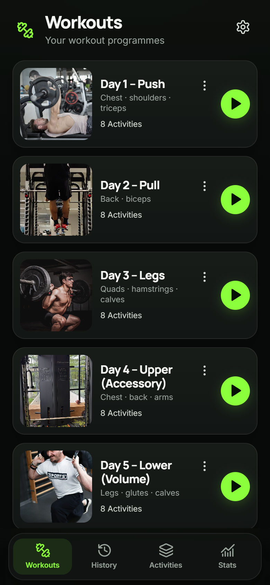
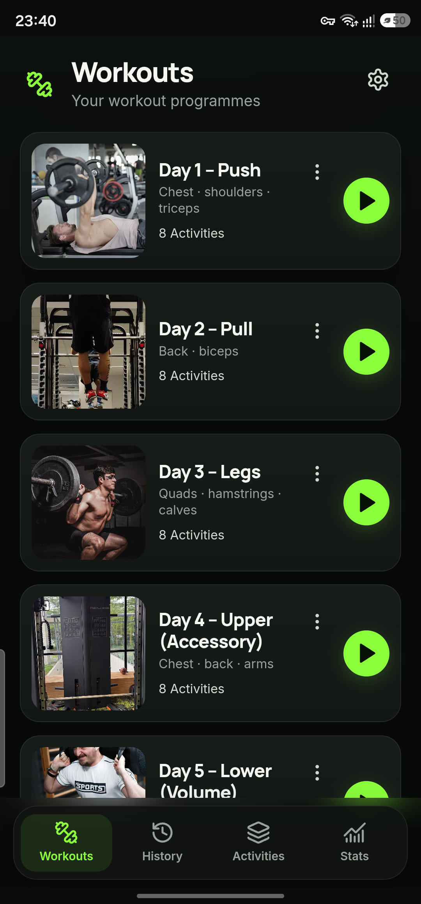

# Form Fitness — simple workout tracker

A deliberately small, local-first workout app built around four tabs:

**Workouts · History · Activities · Statistics**

This repository is the simplified redesign. The completed original Form Fitness app remains preserved in its own repository. The visible app title here is still **Form Fitness**.



More screens: [Activities](docs/screenshots/activities.png) · [Statistics](docs/screenshots/statistics.png) · [Active workout](docs/screenshots/active-workout.png)

## What it does

- **Workouts** — five editable preloaded programmes, large image cards, start/edit/duplicate/delete, and a last-completed marker.
- **History** — completed sessions with date, time and duration. Open a session to correct recorded values; timestamps and duration stay immutable.
- **Active workout** — one scrolling form with a pausable workout timer, a clear cancel action, per-activity countdown timers for duration-based entries, and an independent custom timer.
- **Prefill** — when an exercise has history, every set is prefilled from the most recent recorded occurrence of that exercise **across all programmes**. If it has never been logged, the programme target fills the set count and rep defaults (for example 3 × 8), with weight left blank because no weight targets were supplied.
- **Activities** — a focused library of only the activities used by the five programmes plus Treadmill and Back Stretches. Search, filter, edit, create and delete activities, with custom images.
- **Statistics** — workout count, time, personal records, volume, sets, reps, longest session and streaks, all calculated from real saved sessions. No sample or fabricated numbers.
- **Settings** — kg/lb units, JSON backup/restore, legacy backup download, reset and app information.
- **Android wrapper** — an optional sideloadable APK in `android/` for installing on a phone over ADB.

## Seeded programmes

On a fresh installation the app creates five editable programmes. Each has eight entries in this order:

1. Treadmill (Warm-up) — 5 min · 5 km/h · incline 9
2. Back Stretches — 5 min, editable and notes-supported
3. Five strength exercises in the supplied order
4. Treadmill (Cool-down) — same initial defaults as the warm-up

| Programme | Strength exercises |
|---|---|
| Day 1 – Push | Bench Press, Chest Press, Overhead Press, Lateral Raises, Push-Ups |
| Day 2 – Pull | Pull-Ups, Lat Pulldown, Seated Row, Straight-Arm Pulldown, Barbell Curl |
| Day 3 – Legs | Hack Squat, Belt Squat, Leg Extension, Hamstring Curl, Seated Calf Raise |
| Day 4 – Upper (Accessory) | Chest Press (Light), Cable Fly, Pulldown Bar, Bicep Curl Bar, Tricep Pushdown |
| Day 5 – Lower (Volume) | Goblet Squat, Walking Lunges, Lying Leg Curl, Leg Extension, Seated Calf Raise |

Strength targets are exactly the supplied ones. No weight targets are invented. Clarified source decisions:

- **Cable Fly / Fail Pull** is implemented as **Cable Fly**.
- **Pulldown Bar** is the existing **Lat Pulldown** activity with the programme label “Pulldown Bar”.
- **Chest Press (Light)** shares the Chest Press template with its own programme target.
- **Bicep Curl Bar** shares the Barbell Curl template.
- **Hamstring Curl** and **Lying Leg Curl** are separate activities.
- **Back Stretches** starts at 5 minutes after your confirmation.

## Run it

Requirements: Node.js 22+ and npm. The E2E suite uses the installed Google Chrome (`channel: 'chrome'`).

```bash
npm install
npm run dev       # http://localhost:5173
npm run build
npm run preview   # http://localhost:4173
```

The scripts use `scripts/run.mjs`, which pins temporary build output to the project on Windows.

### Tests

```bash
npm run lint             # strict TypeScript check
npm test                 # 17 Vitest tests
npm run test:e2e         # 19 Playwright checks
npm run test:e2e:prod    # production build + service-worker/offline smoke test
npm run verify           # lint + unit + browser + build + production
```

The browser suite covers seeding, the four-tab shell, programme editing, activity creation/deletion, live logging, prefill, history correction/deletion, PR recalculation, statistics, units, backup/restore and legacy migration.

## Data and privacy

| Data | Storage |
|---|---|
| Activities, programmes, sessions, active workout, settings | `localStorage` key `form-fitness-workout-v1` |
| Legacy backup | `localStorage` key `form-fitness-legacy-backup-v1` |

- No account, network sync, analytics, ads or external data service.
- **Backup & Restore** in Settings exports a complete JSON backup, including user-supplied images and the active draft.
- Import validates the file and asks for confirmation before replacing current data.
- Clearing site data is permanent unless a backup exists.

### Migration from the previous app

The previous Form Fitness release stored its data under `form-fitness-app-v1`. On first boot this app:

1. copies that raw state into a downloadable legacy backup;
2. migrates non-example programmes and completed sessions where possible;
3. preserves custom exercise names through activity snapshots;
4. excludes sample sessions from statistics;
5. ignores the old nutrition, diary, goals, articles, calendar and profile modules, which are no longer part of this product.

The new five example programmes are still installed once. The old data is never silently wiped.

## Design and assets

- Dark charcoal surfaces, vivid lime accent, large photographic cards, 44px+ touch targets and a four-item bottom navigation.
- Photography is bundled locally under `public/images/activities/` so the library works offline.
- Sources and licences are recorded in [`public/images/ATTRIBUTION.md`](public/images/ATTRIBUTION.md). Pexels photos use the Pexels License; the four CC-licensed/CC0 assets retain their attribution.
- The generated visual references supplied with the redesign package were used as design guidance only, not as app assets.

## Android wrapper

```powershell
.\android\build.ps1            # build android/build/form-fitness.apk
.\android\build.ps1 -Install   # build, install over wireless/USB ADB, and launch
```

The wrapper bundles the production web app inside a small WebView shell and serves it from a loopback origin, keeping local storage and IndexedDB persistent. The package id remains `com.kieronpeters.form` so installing over the previous app upgrades it and runs the data migration. It is locally signed for sideloading, not a Play Store artifact. See `android/README.md` for prerequisites.



## Project structure

```text
src/
  components/   shell, navigation, cards, modal, image and log-field primitives
  data/         seed library/programmes, legacy catalog and migration
  lib/          ids, image compression, dates, units, statistics and record logic
  pages/        Workouts, Programme editor, Activities, Activity editor,
                Active workout, History, History detail, Statistics, Settings
  store/        Zustand persisted app data and actions
  styles/       compact design system and page styles
android/        self-contained WebView wrapper and build script
e2e/            Playwright flows, responsive checks and production smoke test
public/         PWA shell, icons, exercise photos and attribution
```

## Known limitations

- Exercise photographs are licensed stock images and may not depict the exact machine or variation available to every user.
- There is no cloud sync, login or social feature; backup/restore is the recovery path.
- The APK is debug-signed for local installation, not Play Store distribution.
- Installing the PWA needs a stable HTTPS origin; the Android wrapper works offline without one.
